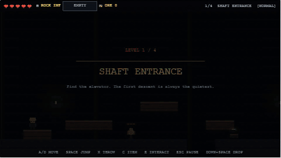

# Mines & Goblins

**A retro mine-crawling action platformer. One rock. Many problems.**

> **Status:** M4 complete — the four-level Normal-mode descent now ends in the Great Worm boss fight, complete with phases, supply drops, boss retry, victory, and a results screen. M5 is next.
>
> The repository was empty when work began, so the documents below define the direction for a new game.



_Shaft Entrance, the opening level of the four-level descent into the Great Worm's arena._

## Concept

Mines & Goblins is a browser-first, retro action platformer inspired by the punishing readability of _Ghosts 'n Goblins_ and the run-based scavenging of _Spelunky_. A stubborn miner descends into a cursed mine with an unlimited supply of rocks, a handful of scavenged weapons, and one very large worm waiting at the bottom.

The game is built around short, replayable runs. Players dodge or defeat enemies, scrounge limited stronger items, and try to finish the mine under self-imposed challenge rules: never kill, use only rocks, or never take a hit.

## Planned v1 features

- **Four handcrafted mine levels plus a boss arena.**
- **Unlimited rocks** that deal 1 damage, with arcing throws and a cooldown.
- **Limited scavenged items** such as knives, a flintlock with bullets, and rune magic. Stronger damage, useful effects, limited ammo.
- **Progressive enemy health** across levels, with a roster built around clear counterplay.
- **A final boss:** a giant worm with multi-phase, telegraphed burrow attacks.
- **Four difficulties:** Normal, Hard, Impossible, and Crazy, each with distinct survival and enemy-health rules.
- **Three challenge runs:** Pacifist, Primitive, and Untouchable, plus achievements and cosmetic skins.
- **Desktop browser release**, keyboard controls, local save data, and GitHub Pages deployment.

## Documentation

- [Game Design Document](docs/game-design.md) — mechanics, content, balance, runs, and progression.
- [Technical Plan](docs/technical-plan.md) — technology choices, architecture, testing, and deployment.
- [Roadmap](docs/roadmap.md) — milestones, estimates, acceptance criteria, and risks.
- [M1 Playtest Notes](docs/m1-playtest.md) — movement/combat checks, tuning values, and known limitations.
- [M2 Playtest Notes](docs/m2-playtest.md) — enemy, item, difficulty, and feedback checks.
- [M3 Level Design Notes](docs/m3-level-design.md) — run order, level intent, exit flow, and QA checklist.
- [M3 Playtest Notes](docs/m3-playtest.md) — route, pause, settings, and full-run checks.
- [M4 Playtest Notes](docs/m4-playtest.md) — boss pacing, visual QA, retry checks, and test coverage.

## Technology at a glance

| Area         | Choice                                             |
| ------------ | -------------------------------------------------- |
| Language     | TypeScript (strict)                                |
| Game engine  | Phaser 4.2.x                                       |
| Build tool   | Vite                                               |
| Level editor | Tiled (JSON maps)                                  |
| Art          | Aseprite, 16×16 tiles, 480×270 internal resolution |
| Audio        | Phaser Web Audio + original/CC0 assets             |
| Tests        | Vitest + Playwright                                |
| CI / hosting | GitHub Actions + GitHub Pages                      |
| Persistence  | Versioned `localStorage` save                      |

See [docs/technical-plan.md](docs/technical-plan.md) for the rationale and alternatives considered.

## Roadmap at a glance

| Milestone | Outcome                                                              |
| --------- | -------------------------------------------------------------------- |
| M0 ✅     | Repository scaffold, tooling, CI, deployable title screen            |
| M1 ✅     | Responsive movement, jumping, rock throwing, damage, retry loop      |
| M2 ✅     | Enemy roster, item arsenal, crates, HUD, combat feedback             |
| M3 ✅     | Four levels, transitions, pause/options, boss placeholder            |
| M4 ✅     | Giant worm boss with phases, supplies, victory, and results screen   |
| M5        | Difficulties, challenge-run tracking, achievements, skins, save data |
| M6        | Final art, audio, UI, accessibility, and content polish              |
| M7        | Balance, external playtests, QA, performance, release candidate      |
| M8        | v1.0 release and deployment                                          |

Full details and acceptance criteria are in [docs/roadmap.md](docs/roadmap.md).

## Getting started

Requires **Node.js 24 or newer**.

```bash
npm install
npm run dev
```

The dev server runs at `http://127.0.0.1:5173/`. Choose **Start Run** to begin the four-level descent at Shaft Entrance and finish in the Great Worm's arena.

### Controls

| Action          | Input                                 |
| --------------- | ------------------------------------- |
| Move            | `A` / `D` or Left / Right             |
| Jump            | `Space` or `Z`                        |
| Throw rock      | `X` or `J`                            |
| Use item        | `C` or `K`                            |
| Interact        | `E`                                   |
| Aim up/down     | `W` / `S` or Up / Down                |
| Drop through    | `Down` + `Jump`                       |
| Pause           | `Esc` or `P`                          |
| Debug overlay   | `F3` (development builds)             |
| Skip level      | `F4` (development builds)             |
| Skip boss phase | `F4` (development builds, boss arena) |
| Defeat boss     | `F6` (development builds, boss arena) |

Rocks are unlimited and deal 1 damage. The one-slot secondary item holds a limited-use Knife, Flintlock, or Rune Scroll; picking up the same item adds ammo up to its cap, while a different item replaces it. Crates contain authored ore, salves, or items, and pedestals hold items that require `E` to collect. Falling into a gap or losing all hearts restarts the level after a short death overlay.

Development builds accept `?difficulty=normal|hard|impossible|crazy` for difficulty-scale checks. The title-screen selector arrives in M5. Development builds also accept `?level=<id>` and `?spawn=exit` for level and elevator QA, plus `?boss=1` to jump directly into the boss arena. The boss test API exposes `hitBoss`, `skipBossPhase`, `defeatBoss`, `defeatPlayer`, `damagePlayer`, and `healPlayer` on `window.__MINES_DEBUG__`.

### Scripts

| Command             | Purpose                                               |
| ------------------- | ----------------------------------------------------- |
| `npm run dev`       | Start the Vite dev server                             |
| `npm run build`     | Typecheck and create the production bundle in `dist/` |
| `npm run preview`   | Preview the production bundle at `/minesNgoblins/`    |
| `npm run lint`      | Run ESLint                                            |
| `npm run format`    | Format the repository with Prettier                   |
| `npm run typecheck` | Run TypeScript without emitting files                 |
| `npm run test`      | Run Vitest unit tests                                 |
| `npm run test:e2e`  | Run Playwright browser tests                          |

Install the Playwright browser once before running E2E tests locally:

```bash
npx playwright install chromium
```

## Deployment

The `Deploy to GitHub Pages` workflow builds and publishes the game on every push to `main`. Enable **Settings → Pages → Source → GitHub Actions** in the GitHub repository before the first deploy.

The production base path defaults to `/minesNgoblins/`. If the site moves to a custom domain or a different repository path, set `VITE_BASE_PATH` (for example, `/` or `/new-repo/`) for the build.

## Project conventions

- All documentation, source code, comments, commit messages, and project discussion are in **English**.
- Game UI text is English for v1, with the text layer kept ready for localization.
- Assets must be original, commissioned, or clearly licensed. A license inventory will live under `docs/` when asset production begins.
- Manual QA notes live in `docs/m1-playtest.md`, `docs/m2-playtest.md`, `docs/m3-playtest.md`, and `docs/m4-playtest.md`.

## License

TBD. The code and asset licenses will be decided before the first public release.
