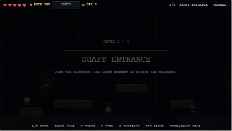

# Mines & Goblins

**A retro mine-crawling action platformer. One rock. Many problems.**

> **Status:** `v1.0.0` released. Balance, hardening, accessibility, performance, browser matrix, licensing, and release packaging are complete. M8 is closed.
>
> The repository was empty when work began, so the documents below define how the game was built.



_Shaft Entrance, the opening level of the four-level descent into the Great Worm's arena._

## Play now

**[mariodod.github.io/minesNgoblins](https://mariodod.github.io/minesNgoblins/)**

Desktop browser, keyboard only. Start a run, pick a difficulty, and descend. The title screen lists the core controls, and **Options → Controls** rebinds every action.

| Action       | Default input             |
| ------------ | ------------------------- |
| Move         | `A` / `D` or Left / Right |
| Jump         | `Space`                   |
| Throw rock   | `X`                       |
| Use item     | `C`                       |
| Interact     | `E`                       |
| Aim up/down  | `Up` / `Down`             |
| Drop through | `Down` + `Jump`           |
| Pause        | `Esc`                     |

## Screenshots

| Title screen                  | Shaft Entrance                    |
| ----------------------------- | --------------------------------- |
| ![Title screen][title-screen] | ![Shaft Entrance][shaft-entrance] |
| **The Great Worm**            | **Run results**                   |
| ![The Great Worm boss][boss]  | ![Run results screen][results]    |

_Captured at 1920×1080 from an automated QA pass, so the Results stats come from a scripted run._

[title-screen]: docs/media/release/title.png
[shaft-entrance]: docs/media/release/level.png
[boss]: docs/media/release/boss.png
[results]: docs/media/release/results.png

## Concept

Mines & Goblins is a browser-first, retro action platformer inspired by the punishing readability of _Ghosts 'n Goblins_ and the run-based scavenging of _Spelunky_. A stubborn miner descends into a cursed mine with an unlimited supply of rocks, a handful of scavenged weapons, and one very large worm waiting at the bottom.

The game is built around short, replayable runs. Players dodge or defeat enemies, scrounge limited stronger items, and try to finish the mine under self-imposed challenge rules: never kill, use only rocks, or never take a hit.

## Features

- **Four handcrafted mine levels plus a boss arena.**
- **Unlimited rocks** that deal 1 damage, with arcing throws and a cooldown.
- **Limited scavenged items** such as knives, a flintlock with bullets, and rune magic. Stronger damage, useful effects, limited ammo.
- **Progressive enemy health** across levels, with a roster built around clear counterplay.
- **A final boss:** a giant worm with multi-phase, telegraphed burrow attacks.
- **Four difficulties:** Normal, Hard, Impossible, and Crazy, each with distinct survival and enemy-health rules.
- **Four challenge badges:** Pacifist, Primitive, Untouchable, and Legend, plus 12 achievements and 9 cosmetic skins.
- **Desktop browser release**, keyboard controls, local save data, and GitHub Pages deployment.

## Documentation

- [Game Design Document](docs/game-design.md) — mechanics, content, balance, runs, and progression.
- [Technical Plan](docs/technical-plan.md) — technology choices, architecture, testing, and deployment.
- [Roadmap](docs/roadmap.md) — milestones, estimates, acceptance criteria, and risks.
- [M1 Playtest Notes](docs/m1-playtest.md) — movement/combat checks, tuning values, and known limitations.
- [M2 Playtest Notes](docs/m2-playtest.md) — enemy, item, difficulty, and feedback checks.
- [M3 Level Design Notes](docs/m3-level-design.md) — run order, level intent, exit flow, and QA checklist.
- [M3 Playtest Notes](docs/m3-playtest.md) — route, pause, settings, and full-run checks.
- [M4 Playtest Notes](docs/m4-playtest.md) — boss pacing, visual QA, retry checks, and test coverage.
- [M5 Test Matrix](docs/m5-test-matrix.md) — difficulty × challenge coverage, Results rules, achievements, skins, and save recovery.
- [M6 QA Notes](docs/m6-qa.md) — asset/audio inventory, text and accessibility checks, browser matrix, performance, and the manual release checklist.
- [M7 QA Notes](docs/m7-qa.md) — balance budget, Crazy tuning, scripted complete runs, hardening, accessibility contrast, performance, and known issues.
- [v1.0.0 Release Notes](docs/release-notes-v1.0.0.md) — features, controls, verification, credits, license, known issues, and rollback.
- [Asset and Dependency Licenses](docs/asset-licenses.md) — original-asset inventory and third-party tool licenses.

## Technology at a glance

| Area         | Choice                                                             |
| ------------ | ------------------------------------------------------------------ |
| Language     | TypeScript 6 (strict)                                              |
| Game engine  | Phaser 4.2.1                                                       |
| Build tool   | Vite 8                                                             |
| Level format | Hand-authored JSON maps, validated at load                         |
| Art          | Generated pixel-art pack, 16×16 tiles, 480×270 internal resolution |
| Audio        | Generated WAV pack + Phaser Web Audio                              |
| Tests        | Vitest + Playwright                                                |
| CI / hosting | GitHub Actions + GitHub Pages                                      |
| Persistence  | Versioned `localStorage` save                                      |

See [docs/technical-plan.md](docs/technical-plan.md) for the rationale and alternatives considered.

## Roadmap at a glance

| Milestone | Outcome                                                              |
| --------- | -------------------------------------------------------------------- |
| M0 ✅     | Repository scaffold, tooling, CI, deployable title screen            |
| M1 ✅     | Responsive movement, jumping, rock throwing, damage, retry loop      |
| M2 ✅     | Enemy roster, item arsenal, crates, HUD, combat feedback             |
| M3 ✅     | Four levels, transitions, pause/options, boss placeholder            |
| M4 ✅     | Giant worm boss with phases, supplies, victory, and results screen   |
| M5 ✅     | Difficulties, challenge runs, achievements, skins, Results, save v1  |
| M6 ✅     | Final art, audio, UI, accessibility, credits, and QA notes           |
| M7 ✅     | Balance, QA, performance, accessibility review, release candidate    |
| M8 ✅     | MIT license, `v1.0.0` tag, GitHub Release, final deploy, smoke tests |

Full details and acceptance criteria are in [docs/roadmap.md](docs/roadmap.md).

## Getting started

Requires **Node.js 24 or newer**.

```bash
npm install
npm run dev
```

The dev server runs at `http://127.0.0.1:5173/`. Choose **Start Run**, pick a difficulty, then descend from Shaft Entrance to the Great Worm's arena. Challenge badges are tracked automatically, and Results explains any badge that failed.

### Controls

The default bindings are listed in [Play now](#play-now). Every action can be rebound in **Options → Controls**.

Rocks are unlimited and deal 1 damage. The one-slot secondary item holds a limited-use Knife, Flintlock, or Rune Scroll; picking up the same item adds ammo up to its cap, while a different item replaces it. Crates contain authored ore, salves, or items, and pedestals hold items that require `E` to collect. Falling into a gap or losing all hearts restarts the level automatically after the death animation.

Development builds accept `?difficulty=normal|hard|impossible|crazy` to preselect a difficulty. `?level=<id>` preselects the starting level, while `?spawn=exit` and `?boss=1` bypass the difficulty screen for direct QA. Production builds ignore these queries. The boss test API exposes `hitBoss`, `skipBossPhase`, `defeatBoss`, `defeatPlayer`, `damagePlayer`, and `healPlayer` on `window.__MINES_DEBUG__`; level scenes expose `defeatAllEnemies` on `window.__MINES_LEVEL_DEBUG__` so the Crazy exit gate can be verified.

### Scripts

| Command             | Purpose                                               |
| ------------------- | ----------------------------------------------------- |
| `npm run dev`       | Start the Vite dev server                             |
| `npm run build`     | Typecheck and create the production bundle in `dist/` |
| `npm run preview`   | Preview the production bundle at `/minesNgoblins/`    |
| `npm run lint`      | Run ESLint                                            |
| `npm run assets`    | Regenerate the committed art, animations, and font    |
| `npm run format`    | Format the repository with Prettier                   |
| `npm run typecheck` | Run TypeScript without emitting files                 |
| `npm run test`      | Run Vitest unit tests                                 |
| `npm run test:e2e`  | Run Playwright browser tests                          |

Repeatable QA helpers:

```bash
# Frame-rate and load sample for a scene, headed hardware or headless software
node tools/qa/profile.mjs --url http://127.0.0.1:4173/minesNgoblins/ --viewport 1920x1080 --headed

# Visual checklist capture at 1366x768, 1920x1080, and 2560x1440
node tools/qa/screenshots.mjs --url http://127.0.0.1:5173/

# Production smoke test: errors, load budget, and absent debug hooks
node tools/qa/smoke.mjs --url https://mariodod.github.io/minesNgoblins/

# Same check in Edge, Firefox, or WebKit
node tools/qa/smoke.mjs --url https://mariodod.github.io/minesNgoblins/ --browser firefox
```

Install the Playwright browser once before running E2E tests locally:

```bash
npx playwright install chromium
```

## Deployment

The `Deploy to GitHub Pages` workflow builds and publishes the game on every push to `main`. Enable **Settings → Pages → Source → GitHub Actions** in the GitHub repository before the first deploy.

The production base path defaults to `/minesNgoblins/`. If the site moves to a custom domain or a different repository path, set `VITE_BASE_PATH` (for example, `/` or `/new-repo/`) for the build.

Release `v1.0.0` is tagged from the deployed commit. To roll back, re-run the deploy workflow from an earlier tag or `git revert` the offending commit; GitHub Pages keeps the previous deployment in the Actions history.

## Project conventions

- All documentation, source code, comments, commit messages, and project discussion are in **English**.
- Game UI text is English. There is no localization layer in v1.
- Assets must be original, commissioned, or clearly licensed. The generated art and audio packs are original work; the full inventory is in [`docs/asset-licenses.md`](docs/asset-licenses.md).
- Manual QA notes live in `docs/m1-playtest.md`, `docs/m2-playtest.md`, `docs/m3-playtest.md`, `docs/m4-playtest.md`, `docs/m5-test-matrix.md`, `docs/m6-qa.md`, and `docs/m7-qa.md`.

## Credits

Created by [mariodod](https://github.com/mariodod). All art, audio, the bitmap font, level data, and code are original work generated or authored for this project.

- **Engine:** [Phaser](https://phaser.io/) 4.2 (MIT)
- **Build:** [Vite](https://vite.dev/) (MIT)
- **Tests:** [Playwright](https://playwright.dev/) (Apache-2.0) and [Vitest](https://vitest.dev/) (MIT)

The in-game **Credits** screen and [`docs/asset-licenses.md`](docs/asset-licenses.md) list every asset and third-party tool.

## Known issues

- **No external human playtest (P2).** Route pacing, per-difficulty fairness, and first-time onboarding are backed by scripted runs and automated checks, not by watching a new player.
- **Cold CDN start (P3).** The first request after a fresh Pages deployment can exceed the 3-second budget while the GitHub Pages edge warms; warm loads are under 1.5 seconds.
- **Quit → new-run report (P4).** The reported hang was root-caused and fixed in `v0.7.0`, with a regression test, but the reporter's exact steps were never captured.

No P0 or P1 issues are open. The full list is in [M7 QA Notes](docs/m7-qa.md#known-issues).

## License

Released under the [MIT License](LICENSE). All bundled art, audio, and font files are original works and are covered by the same license; see [`docs/asset-licenses.md`](docs/asset-licenses.md) for the inventory and third-party tool licenses.
